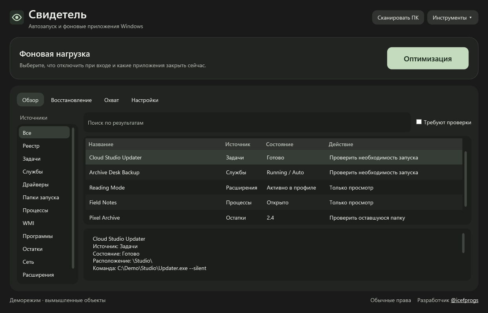

# Свидетель / Svidetel

**Что работает на вашем ПК, почему запускается и как взять это под контроль.**

Локальный инспектор Windows, с поиском скрытых от обычной автозагрузки точек запуска, отключением по кнопке и журналом восстановления.

Разработчик: [@icefprogs](https://github.com/icefprogs). Лицензия MIT. Версия **0.2.0 preview**.




«Оптимизация» собирает поддерживаемые точки запуска в одном окне. Отметьте записи для отключения или открытые приложения для обычного закрытия. Настройки автозапуска можно вернуть через историю. Запуск службы меняется на будущее. Открытое приложение получает запрос закрытия и может предложить сохранить данные. Для процессов и записей запуска карточка показывает совпадающие пути EXE. Отсутствующий EXE в доступной локальной папке помечается для ручной проверки. Карточка рекомендует действие для конкретного источника. Службы связываются с работающими процессами по PID в снимке.

«Свернуть в трей» оставляет приложение открытым в фоне. При включённом наблюдении Windows показывает уведомление о возврате отключённой записи.

## Возможности

- Run/RunOnce HKCU/HKLM, включая WOW6432Node, задачи планировщика, службы, драйверы и папки автозагрузки.
- Процессы с командами и родительскими PID; постоянные WMI-подписки и потребители событий.
- Классические программы, TCP-соединения и локальные UDP-адреса, файлы расширений Chrome/Edge.
- Поиск, фильтры, карточки объектов, локальная проверка Authenticode и SHA-256.
- Отключение поддерживаемых сторонних записей реестра, задач, служб и ярлыков автозагрузки.
- Сохранение исходных параметров **до изменения**, проверка результата, восстановление с отказом перезаписывать изменённые объекты.
- Сравнение снимков и список источников, к которым не удалось получить доступ.
- Наблюдение за повторной активацией раз в минуту, пока приложение открыто. Уведомление через значок Windows. После выхода наблюдение останавливается.
- Инвентаризация выбранной папки, экспорт JSON и деморежим.

## Запуск

Windows 10/11 x64, Windows PowerShell 5.1. Сборке с зависимостью от среды нужен **.NET Desktop Runtime 10 x64**. Автономная сборка включает среду выполнения.

Распакуйте **весь** архив и запустите `Svidetel.exe`. `Bridge.ps1` должен находиться рядом: подмена скрипта равнозначна подмене приложения.

1. Нажмите **«Сканировать ПК»**.
2. Выберите объект, изучите команду, источник и назначение.
3. При необходимости получите подпись и хеш файла.
4. Нажмите **«Отключить запуск»** и подтвердите последствия.
5. Вернуть исходное состояние можно во вкладке **«История и восстановление»**.

Обычных прав достаточно для части проверок. Для системных источников может потребоваться запуск от администратора через стандартный UAC. При запуске под другой учётной записью HKCU и журнал принадлежат уже ей.

## Границы

Это **не антивирус** и не доказательство отсутствия заражения. Неизвестный файл и отсутствие подписи не являются вердиктом о вредоносности.

Драйверы, WMI, процессы, программы, сеть и расширения доступны только для просмотра. Для удаления программ есть переход в настройки Windows. Файлы автоматически не удаляются. В окне оптимизации можно запросить штатное закрытие выбранных приложений с окнами в своей Windows-сессии. Системные процессы, службы и чужие приложения из этого списка исключаются. Доступная кнопка не означает рекомендацию обязательно отключить объект.

Изменения блокируются для задач Microsoft, файлов в Windows, компонентов Defender, подписанных Microsoft компонентов, относительных и несуществующих путей. Некоторые сторонние записи из-за этого останутся только для просмотра. Записи запуска скриптов через системные интерпретаторы отключать нельзя.

Отключение **не останавливает уже работающую службу или процесс** и может нарушить фоновые функции приложения. Windows не предоставляет общей транзакции для всех механизмов: полностью исключить гонки с внешними изменениями нельзя.

Происхождение старых объектов задним числом не восстанавливается. PID мог быть повторно использован. Сравнение снимков не устанавливает виновника. Наблюдение сообщает о возврате, но не обещает назвать восстановивший запись процесс.

Не покрываются другие пользовательские профили, Firefox, UWP-инвентарь, все механизмы COM/Winlogon/IFEO и скрытые от ОС объекты. Расширение на диске не обязательно включено. Ошибка источника делает сравнение неполным. Обход папки ограничен 50 000 файлами, пропускает reparse points и не анализирует содержимое на вредоносность.

## Приватность

Нет встроенной телеметрии и загрузки файлов. Проверка подписи может инициировать системные сетевые проверки сертификатов Windows. «Журнал запуска» сохраняет до 300 доступных событий Windows Security 4688 за последние сутки. Чтение требует доступа к журналу и заранее включённого аудита создания процессов. Связь с работающим процессом проверяется по PID, пути и времени запуска. Командные строки из журнала не собираются. Снимки и журнал: `%LOCALAPPDATA%\Svidetel`. Журнал содержит команды и содержимое отключённых ярлыков, не зашифрован и не защищён от изменения владельцем аккаунта. Не используйте чужие журналы. Восстановление ярлыка возвращает байты, но не исходные временные метки/ACL.

Экспорт может содержать имена пользователей, пути, токены в командах и сетевые адреса. Перед публикацией проверяйте его вручную. Не добавляйте снимки реального ПК в Git.

## Сборка и тесты

```powershell
dotnet restore Svidetel/Svidetel.csproj --configfile NuGet.Config
dotnet build Svidetel/Svidetel.csproj -c Release
dotnet run --project Svidetel -- --demo
dotnet run --project tests/Svidetel.Tests.csproj -c Release
./scripts/build.ps1 -SelfContained
```

WPF + C#, фиксированный PowerShell-мост. Нет сторонних NuGet-зависимостей. Запросы передаются через stdin как JSON, без `Invoke-Expression`.

Дополнительные проверки, предпочтительно в VM:

```powershell
./tests/bin/Release/net10.0-windows/Svidetel.Tests.exe --scan
./tests/bin/Release/net10.0-windows/Svidetel.Tests.exe --integration
```

Вторая команда создаёт уникальную тестовую HKCU Run запись, проверяет отключение, восстановление и отказ перезаписывать чужое изменение. Очистка в `finally`. Существующие записи не изменяются. CI выполняет сборку, тесты и прикладывает ZIP к запуску Actions.

## Дальше

- Независимый аудит и публикация подписанной сборки. Скрипт сборки умеет подписать и проверить собственный EXE через SignTool с параметрами `-SigningThumbprint` и `-TimestampUrl`. Для этого нужен сертификат издателя с доступным закрытым ключом. ZIP и PowerShell-мост этой опцией не подписываются.
- Дополнительные источники подтверждённого происхождения запусков.
- Проверка остатков по сведениям об установке и удалении программ.
- Расширение покрытия источников Windows и браузеров.

Preview не подписан и не проходил независимый аудит. Изменения механизмов запуска сначала проверяйте в виртуальной машине.
