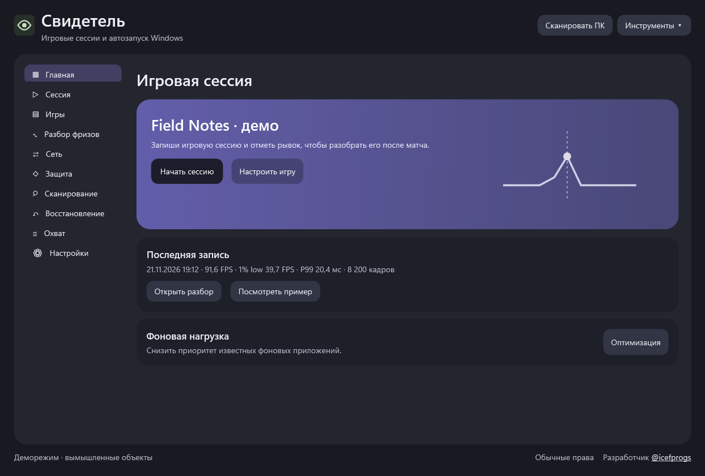
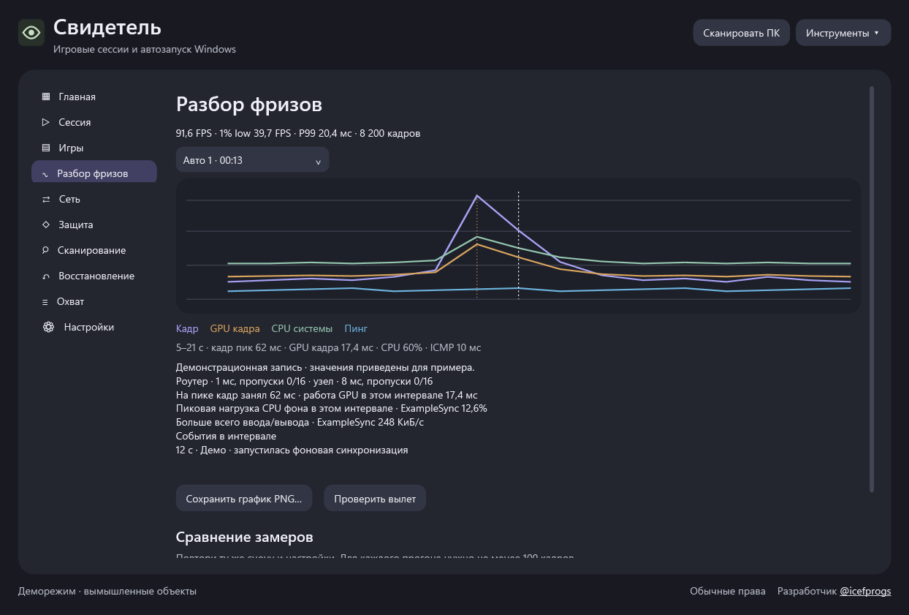
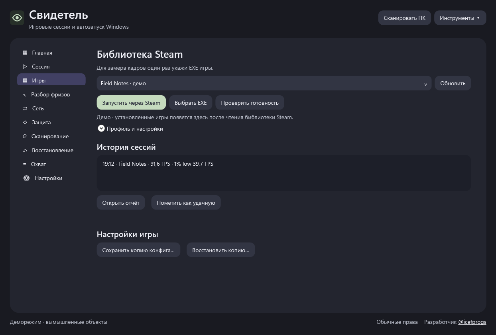
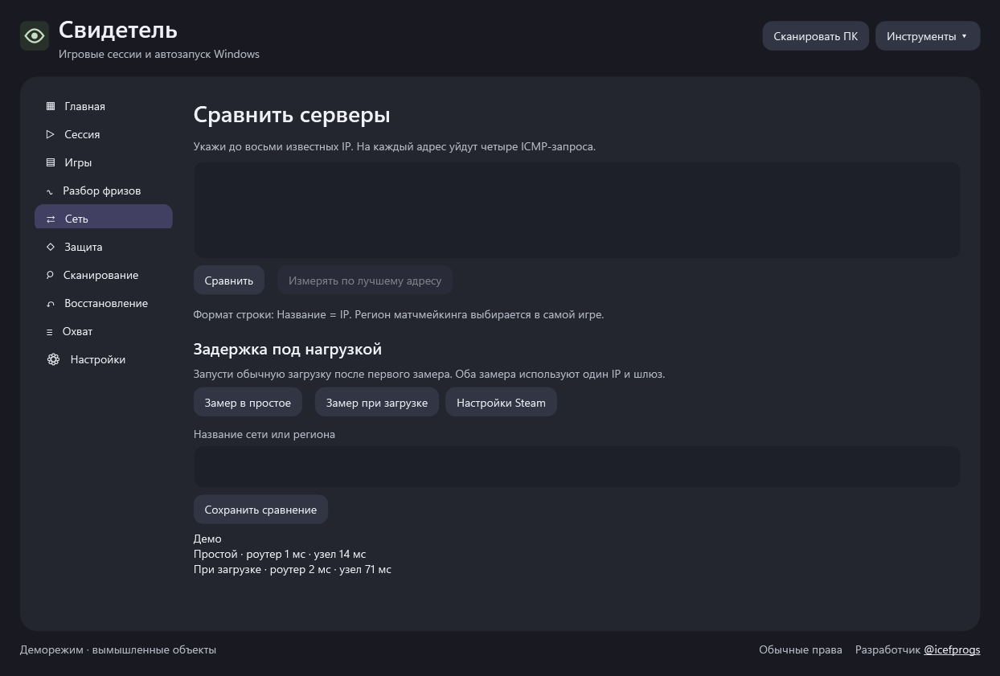
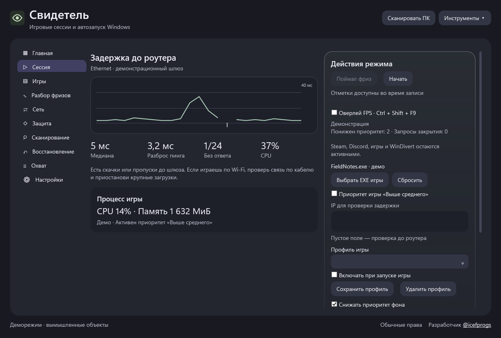
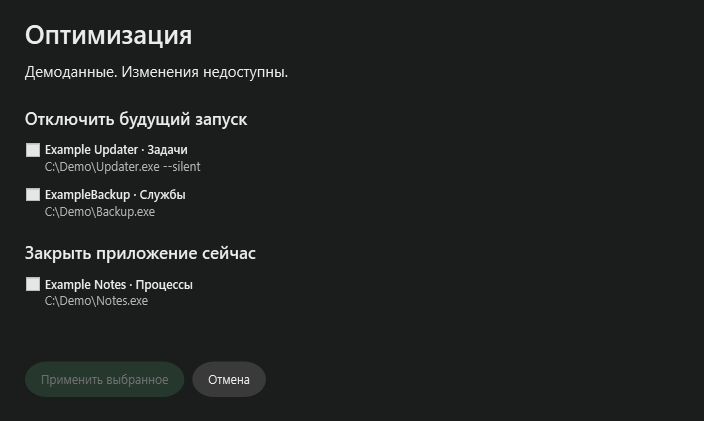
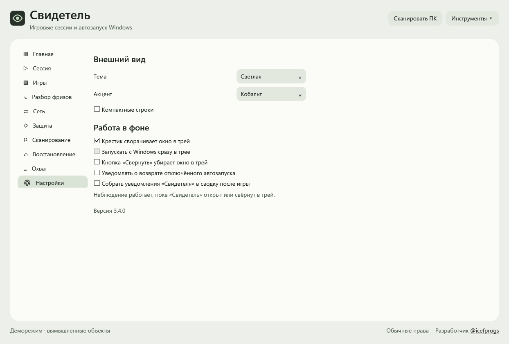

# Свидетель / Svidetel

**Проверьте, что нагружает ПК во время игры, и разберитесь со скрытым автозапуском Windows.**

Локальный инспектор Windows, с поиском скрытых от обычной автозагрузки точек запуска, отключением по кнопке и журналом восстановления.

[**Скачать установщик для Windows x64**](https://github.com/icefprogs/svidetel/releases/latest/download/Svidetel-Setup-x64.exe) · [Портативный ZIP](https://github.com/icefprogs/svidetel/releases/latest/download/Svidetel-windows-x64.zip)

Выберите `Svidetel-Setup-x64.exe` для установки с ярлыками или распакуйте весь портативный ZIP и запустите `Svidetel.exe`. Оба комплекта включают .NET.

Разработчик — [@icefprogs](https://github.com/icefprogs). Лицензия MIT. [Все выпуски](https://github.com/icefprogs/svidetel/releases).















«Оптимизация» одним нажатием снижает приоритет распознанных копий OneDrive, Dropbox, Google Drive, Spotify и Creative Cloud, запущенных в текущей пользовательской сессии. Кнопка «Отменить» возвращает исходный приоритет. Действия над автозапуском и закрытие выбранных окон доступны через «Инструменты» → «Управление автозапуском». Рядом с кнопкой применения видны текущий объект и ход работы.

## Режим геймера

- Выберите исполняемый файл игры и включите режим. «Свидетель» найдёт этот процесс, даже если запустить игру чуть позже, и покажет её загрузку CPU и рабочий набор памяти.
- Можно временно повысить приоритет выбранной игры до «Выше среднего». Статус показывает, удалось ли изменить приоритет. Измерение ресурсов доступно и без повышения. Влияние на FPS зависит от игры и текущей нагрузки.
- График измеряет задержку, её разброс и пропуски ответов до роутера или указанного IPv4/IPv6. Это ICMP. Игровая задержка и частота кадров доступны в самой игре.
- Сохраняет Steam, Discord, игры, WinDivert и другие процессы вне списка фоновых приложений. Можно включить штатное закрытие окон известных фоновых программ или переключение на уже доступный план высокой производительности от сети.
- Кнопка «Завершить режим» возвращает приоритеты и выбранный режимом план питания. Обычный выход также восстанавливает параметры. После аварийного завершения приложение пробует восстановить их при следующем запуске.
- Диагностика работает без загрузки телеметрии. Проверка сети посылает ICMP шлюзу или одному указанному адресу. Некоторые адресаты игнорируют эти запросы. Доступны переходы к игровому режиму, настройкам графики и лимитам фоновых загрузок Windows.

## Разбор фризов

Выберите EXE игры и начните сессию. Во время игры нажмите **Ctrl + Shift + F8**, чтобы отметить рывок. После остановки сессии в разделе «Разбор фризов» доступны окно ±8 секунд вокруг отметки, пинг, CPU системы, время кадра и время работы GPU на кадр. На графике метрики используют свои шкалы. Запись кадров использует PresentMon и продолжает сбор CPU и сети, если система не предоставила доступ к ETW.

Два прогона одной сцены можно сохранить в «До» и «После». Средний FPS считается по кадрам основной цепочки вывода, 1% low — по среднему времени самого медленного процента кадров, P99 — как 99‑й процентиль времени кадра. При недостаточном числе кадров сравнение отключено. Сессии и профили хранятся локально.

Сохранённый автопрофиль запускает сессию при обнаружении выбранного EXE, пока «Свидетель» работает, и завершает её после выхода из игры. Временные изменения приоритета и плана питания возвращаются. В разделе «Серверы» можно сравнить до восьми известных IP по ответам и задержке, затем выбрать регион в меню игры.

## Игровые инструменты 3.4

- Во вкладке «Игры» выбери установленную игру Steam и один раз укажи её EXE. Запуск через Steam применяет профиль и сравнивает ICMP до шлюза и настроенного IP до и после запуска. Steam сам ставит фоновые загрузки на паузу, когда в нём запрещены загрузки во время игры. Состояние очереди и скорость берутся из доступных локальных данных клиента. Пинг матча зависит от самой игры и её маршрута.
- Разбор отмечает всплески времени кадра автоматически после получения базового интервала кадров. На шкале видны совпадения с нагрузкой CPU фона, общим вводом/выводом процессов и событиями Windows. Разбор по окончании долгой сессии сравнивает время кадра, память игры и частоту CPU, если Windows отдаёт эти данные. PNG содержит только график и метрики.
- В «Сети» можно сохранить пары замеров в простое и при своей загрузке. Замеры отправляют ICMP до одного указанного IP и доступного шлюза IPv4. Показатели пропусков включают только выполненные пробы. Используй один и тот же маршрут для пары.
- Оверлей для оконного и безрамочного режима показывает метрики PresentMon поверх активной игры. **Ctrl + Shift + F9** переключает его, **Ctrl + Shift + F8** отмечает фриз. **Ctrl + K** ищет среди разделов, игр, доступных результатов сканирования и сохранённых сессий.
- В «Играх» можно сохранить копию выбранного конфига и отметить удачную сессию для сравнения. Хранилище локальное. При восстановлении создаётся копия текущего файла. «Инструменты → Рост папок» сравнивает размеры вложенных папок в двух снимках.

## Защита и трей

Раздел «Защита» показывает статус Microsoft Defender, обнаружения, действия защиты и процессы, замеченные после запуска приложения. Проверку и блокировку угроз выполняет Microsoft Defender в соответствии с настройками Windows. Из раздела можно отправить выбранный файл на проверку.

Крестик скрывает окно в трей. Для полного выхода используйте «Выйти» в меню значка. В настройках можно включить запуск при входе в Windows сразу в трее. Повторный запуск ярлыка открывает существующее окно.

Для процессов и записей запуска карточка показывает совпадающие пути EXE. Отсутствующий EXE в доступной локальной папке помечается для ручной проверки. Службы связываются с работающими процессами по PID в снимке.

В меню «Инструменты» находятся проверка папки, экспорт, журнал запусков и сворачивание в трей. В «Настройках» можно выбрать тёмную, светлую или системную тему, цвет акцента, плотность списка и поведение при сворачивании. Если наблюдение включено, Windows показывает уведомление при возврате отключённой записи.

## Возможности

- Run/RunOnce HKCU/HKLM, включая WOW6432Node, политики входа Explorer Run, Winlogon Shell/Userinit, задачи, службы, драйверы и папки автозагрузки.
- Процессы с командами и родительскими PID; постоянные WMI-подписки и потребители событий.
- Классические установки и пакеты AppX/MSIX текущего пользователя, TCP-соединения и локальные UDP-адреса.
- Расширения Chrome, Edge, Brave, Vivaldi, Яндекс Браузера и Firefox в стандартных папках профилей. Для Firefox показывается статус, сохранённый в профиле.
- Связь процессов и задач с доступными событиями Windows Security 4688, Sysmon 1 и Task Scheduler 129.
- Фильтр «Требуют проверки» показывает отсутствующие исполняемые файлы и папки, сохранившиеся после подтверждённого удаления MSI.
- Поиск, карточки объектов, локальная проверка Authenticode и SHA-256.
- Отключение поддерживаемых сторонних записей реестра, задач, служб и ярлыков автозагрузки.
- Сохранение исходных параметров **до изменения**, проверка результата, восстановление с отказом перезаписывать изменённые объекты.
- Сравнение снимков и список источников, к которым не удалось получить доступ.
- Наблюдение за повторной активацией раз в минуту, пока приложение открыто. Уведомление через значок Windows. После выхода наблюдение останавливается.
- Инвентаризация выбранной папки, экспорт JSON и деморежим.

## Запуск

Windows 10 22H2 или Windows 11 x64, Windows PowerShell 5.1. Мастер установки добавляет приложение в меню «Пуск» и предлагает ярлык на рабочем столе. Удаление доступно в «Установленных приложениях» Windows. Сборке с зависимостью от среды нужен **.NET Desktop Runtime 10 x64**. Автономная сборка включает среду выполнения.

Распакуйте **весь** архив и запустите `Svidetel.exe`. `Bridge.ps1` должен находиться рядом: подмена скрипта равнозначна подмене приложения.

1. Нажмите **«Сканировать ПК»**.
2. Выберите объект, изучите команду, источник и назначение.
3. При необходимости получите подпись и хеш файла.
4. Нажмите **«Отключить запуск»** и подтвердите последствия.
5. Вернуть исходное состояние можно во вкладке **«Восстановление»**.

Обычных прав достаточно для части проверок. Для системных источников может потребоваться запуск от администратора через стандартный UAC. При запуске под другой учётной записью HKCU и журнал принадлежат уже ей.

## Границы

Это **не антивирус** и не доказательство отсутствия заражения. Неизвестный файл и отсутствие подписи не являются вердиктом о вредоносности.

Драйверы, WMI, процессы, программы, сеть и расширения доступны только для просмотра. Для удаления программ есть переход в настройки Windows. Файлы автоматически не удаляются. В окне оптимизации можно запросить штатное закрытие выбранных приложений с окнами в своей Windows-сессии. Системные процессы, службы и чужие приложения из этого списка исключаются. Доступная кнопка не означает рекомендацию обязательно отключить объект.

Изменения блокируются для задач Microsoft, файлов в Windows, компонентов Defender, подписанных Microsoft компонентов, относительных и несуществующих путей. Некоторые сторонние записи из-за этого останутся только для просмотра. Записи запуска скриптов через системные интерпретаторы отключать нельзя.

Отключение **не останавливает уже работающую службу или процесс** и может нарушить фоновые функции приложения. Windows не предоставляет общей транзакции для всех механизмов: полностью исключить гонки с внешними изменениями нельзя.

Происхождение старых объектов задним числом не восстанавливается. PID мог быть повторно использован. Сравнение снимков не устанавливает виновника. Наблюдение сообщает о возврате, но не обещает назвать восстановивший запись процесс.

Сканирование охватывает текущий профиль Windows и перечисленные источники. В Chromium проверяются манифесты расширений на диске, состояние включения по ним не определяется.

В разделе «Остатки» папка появляется после двух успешных снимков установленных программ. Между снимками должна исчезнуть установка, а журнал MsiInstaller 1034 должен подтвердить успешное удаление с совпадающими названием, версией и издателем. Проверка ограничена локальными каталогами под Program Files. Карточка открывает папку для ручной проверки. Файлы внутри могут принадлежать пользователю или другой программе. Ошибка источника делает сравнение неполным. Обход папки ограничен 50 000 файлами, пропускает reparse points и не анализирует содержимое на вредоносность.

## Приватность

Нет встроенной телеметрии и загрузки файлов. Проверка подписи может инициировать системные сетевые проверки сертификатов Windows. Сканирование читает до 300 событий за сутки из каждого доступного журнала Windows Security 4688, Sysmon 1 и Task Scheduler 129. Для первых двух связь с процессом проверяется по PID, пути и времени запуска. Событие Планировщика показывает зарегистрированный им путь задачи и PID. Для остатков читаются до 500 событий MsiInstaller 1034 за 30 дней. Журналы читаются с текущими правами и настройками Windows. Командные строки из журнала не собираются. Снимки и журнал: `%LOCALAPPDATA%\Svidetel`. Журнал содержит команды и содержимое отключённых ярлыков, не зашифрован и не защищён от изменения владельцем аккаунта. Не используйте чужие журналы. Восстановление ярлыка возвращает байты, но не исходные временные метки/ACL.

Экспорт может содержать имена пользователей, пути, токены в командах и сетевые адреса. Перед публикацией проверяйте его вручную. Не добавляйте снимки реального ПК в Git.

## Сборка и тесты

```powershell
dotnet restore Svidetel/Svidetel.csproj --configfile NuGet.Config
dotnet build Svidetel/Svidetel.csproj -c Release
dotnet run --project Svidetel -- --demo
dotnet run --project tests/Svidetel.Tests.csproj -c Release
./scripts/build.ps1 -SelfContained
./scripts/build.ps1 -Installer
./scripts/build.ps1 -Installer -WithPresentMon
```

Для сборки установщика нужен Inno Setup 6. Скрипт создаёт `artifacts/Svidetel-Setup-x64.exe`, портативный ZIP и контрольные суммы. Опция `-WithPresentMon` включает консольный PresentMon 2.6.0 x64 и его лицензию MIT. Сборка проверяет SHA‑256 бинарника. WPF и C# используют фиксированный PowerShell-мост без сторонних NuGet-зависимостей. Запросы передаются через stdin как JSON, без `Invoke-Expression`.

Дополнительные проверки, предпочтительно в VM:

```powershell
./tests/bin/Release/net10.0-windows/Svidetel.Tests.exe --scan
./tests/bin/Release/net10.0-windows/Svidetel.Tests.exe --integration
```

Вторая команда создаёт уникальную тестовую HKCU Run запись, проверяет отключение, восстановление и отказ перезаписывать чужое изменение. Очистка в `finally`. Существующие записи не изменяются. CI выполняет сборку и тесты, а также прикладывает установщик, ZIP и контрольные суммы к запуску Actions.

## Подпись и независимый аудит

Сборка для публичного выпуска с доверенным сертификатом издателя и RFC 3161-меткой времени:

```powershell
./scripts/build.ps1 -Installer -RequireSignature -SigningThumbprint '<отпечаток>' -TimestampUrl '<HTTPS-адрес службы меток времени>'
```

Скрипт ищет сертификат с закрытым ключом в личном хранилище Windows, подписывает `Svidetel.exe` и установщик, проверяет отпечаток и метку времени. Контрольные суммы сохраняются рядом с обоими пакетами. Подпись EXE не распространяется на ZIP, PowerShell-мост или прочие файлы комплекта.

Независимый аудит пока не проведён. Область проверки для внешнего ревьюера включает интерфейс между WPF и PowerShell, правила допуска к отключению, проверку идентичности объекта перед изменением, восстановление после сбоя и целостность релизного архива.
